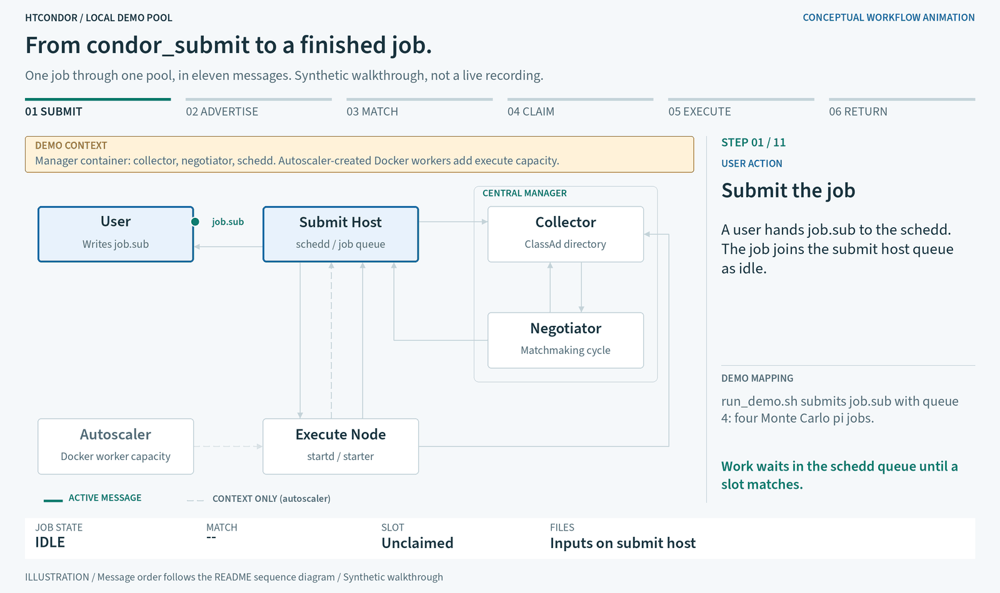
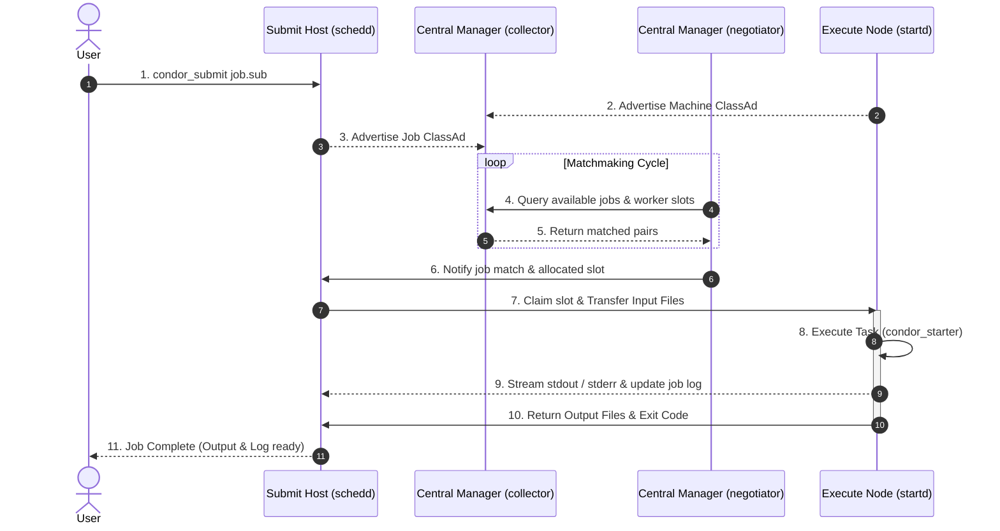
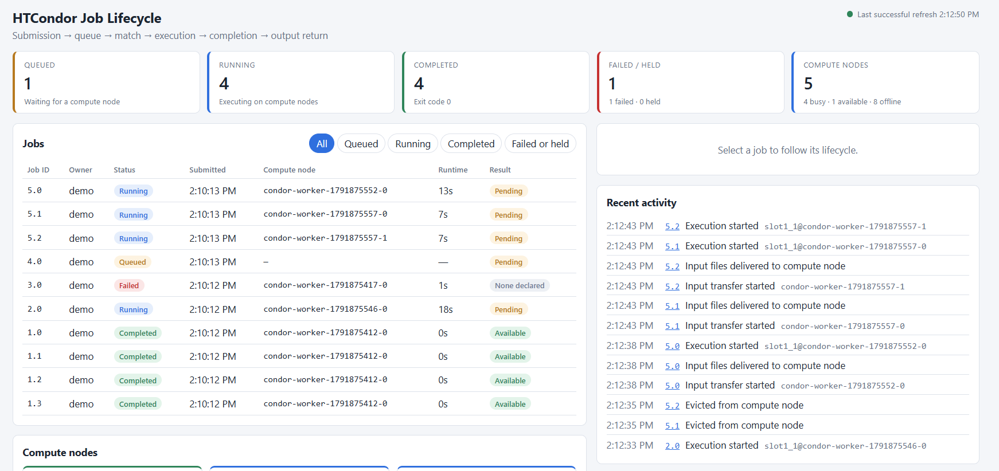
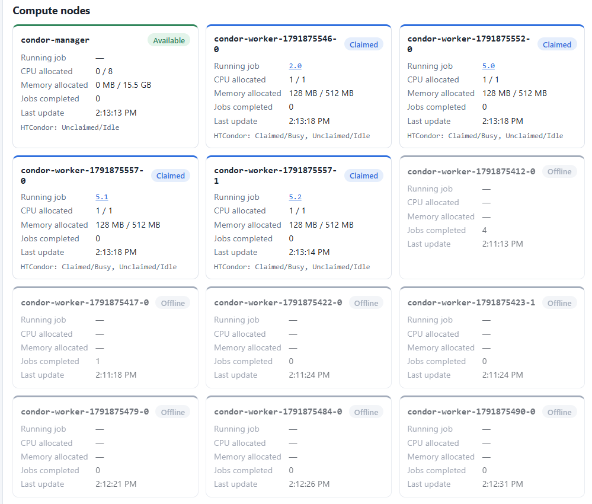
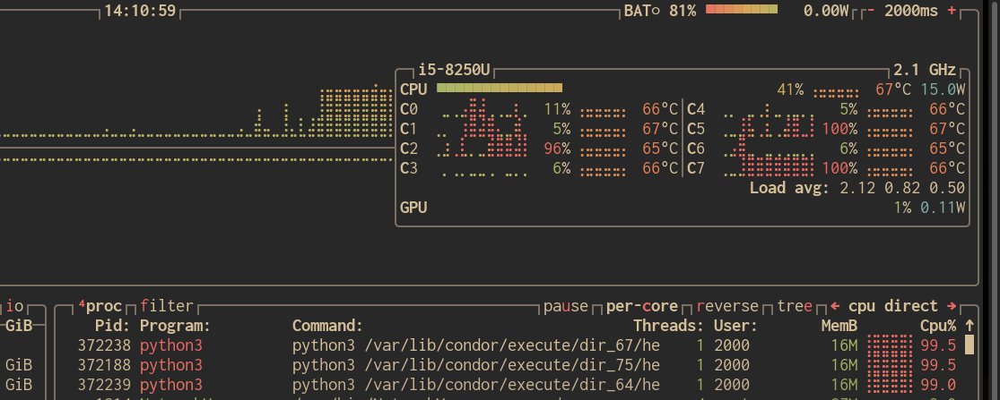

# HTCondor_demo


This repository provides a local Docker Compose demonstration of an HTCondor pool. A manager container runs the collector, negotiator, schedd, and startd. A Python autoscaler observes the schedd over SSH, creates labeled worker containers through the Docker API, and removes idle workers.

## Why This Project Was Born

Our day-to-day work revolves around scientific computation: simulations, parameter sweeps, and numerical models, along with the ongoing effort to make them cheaper and faster. Our requirements are specific enough that off-the-shelf solutions rarely fit as-is, so we need an approach we can shape around our own workloads.

Several recurring problems motivated this proof of concept:

- **Bursty demand.** Compute needs arrive in waves. A fixed cluster sized for peak load sits idle most of the time, while one sized for average load builds long queues during peaks.
- **Many independent jobs.** Most workloads are embarrassingly parallel: hundreds or thousands of runs that differ only in their inputs. Overall throughput matters more than the speed of any single run.
- **Cost pressure.** Paying for idle machines is wasteful. Capacity should follow the queue, growing when work arrives and shrinking when it is done.
- **Heterogeneous resources.** Jobs have different CPU and memory needs, and available machines vary. The scheduler must match each job to a suitable slot rather than assume uniform hardware.
- **Reliability.** Long-running calculations should survive the loss of a worker and be retried or held, not silently lost.
- **Visibility.** Users and operators need to see what is queued, running, failed, or stuck without logging into individual machines.

This repository is a small, self-contained MVP that tests whether HTCondor, paired with a lightweight autoscaler and a monitoring dashboard, addresses these needs. It runs entirely on a single machine with Docker Compose, so the concept can be evaluated, demonstrated, and iterated on before any investment in real infrastructure.

### Goals of the MVP

- Show the full job lifecycle: submit, match, transfer inputs, execute, and return outputs.
- Demonstrate queue-driven scaling of workers up and down.
- Exercise realistic scenarios: successful, long-running, failing, unmatchable, and CPU-heavy jobs.
- Provide a dashboard that makes pool and job state observable at a glance.

### Out of scope

- Production hardening, multi-host networking, authentication beyond the local demo, and cloud provider integration. See [Security and scope](#security-and-scope).

---


## Why use HTCondor

HTCondor is a high-throughput computing (HTC) workload manager. Where an HPC scheduler optimizes a single tightly coupled job to finish as fast as possible, HTCondor targets many loosely coupled jobs that run over hours, days, or months and tries to keep every available machine busy. Progress is measured in jobs completed per month rather than floating-point operations per second. That model suits embarrassingly parallel work such as the Monte Carlo runs in this demo.

This pool relies on HTCondor for several reasons:

- **Matchmaking and scheduling.** The collector aggregates machine and job ClassAds and the negotiator pairs queued jobs with available slots, so the pool self-organizes as workers come and go.
- **Elastic, heterogeneous pools.** Execute nodes advertise their slots to the central manager. The autoscaler in this repository adds and removes Docker workers at runtime, and HTCondor absorbs the churn without reconfiguration.
- **Built-in file transfer.** `transfer_input_files` and `transfer_output_files` move the executable, inputs, and results between the submit host and the workers, so jobs need no shared filesystem.
- **Fault tolerance.** A job that loses its slot is held or requeued rather than lost, which matters when workers are created and destroyed on demand.
- **No application changes.** Ordinary serial programs run unchanged under the vanilla universe, with no special library to link against and no rewrite for the cluster.
- **Mature ecosystem.** DAGMan expresses job dependencies, and HTCondor spans local clusters, campus machines, cloud, and grid resources from the same submit interface.

The result is that compute becomes a fungible pool: queue demand drives container creation, HTCondor routes work to whatever slots appear, and idle capacity is reclaimed automatically.

## Prerequisites

- Linux Docker Engine with Docker Compose v2
- Python 3.10 or newer for host unit tests
- Membership in the host `docker` group, or equivalent access to `/var/run/docker.sock`
- `ssh-keygen` for the temporary key used between the autoscaler and manager

The demo uses the official `htcondor/mini:lts` and `htcondor/execute:lts` images. The manager and worker images add only the repository configuration and local entrypoints.

## Workflow

### Animated GIF workflow



### Standard Mermaid chart workflow



## Quick start

```sh
./run_demo.sh
```

The script builds the images, starts the manager and autoscaler, submits four Monte Carlo pi jobs through HTCondor file transfer, verifies all four JSON results, and removes the containers, network, and output volume. The output is verified before cleanup and is not retained after a successful run.

### Dashboard demo

```sh
./run_demo.sh --dashboard
```

This also starts the monitoring dashboard at http://127.0.0.1:8080 and submits the demo scenarios: successful, long-running, failing, unmatchable (stays queued) and three CPU-bound heat-diffusion jobs that each run for about 5 minutes. Press Ctrl+C to stop and clean up.





### Heavy workload

`workload_demo/heavy.sub` submits three CPU-bound 2D heat-diffusion simulations (`heat_diffusion.py`), each running for about 5 minutes. While they run, each job keeps a host CPU core near 100%:



## Manual inspection

Run the automated checks without Docker:

```sh
python3 -m unittest discover -s tests -v
```

To inspect an interactive session, create the temporary SSH material and keep the services running:

```sh
mkdir -p .demo/ssh
ssh-keygen -q -t ed25519 -N '' -f .demo/ssh/id_ed25519
export CONDOR_SSH_PUBLIC_KEY="$(<.demo/ssh/id_ed25519.pub)"
export DOCKER_UID="$(id -u)"
export DOCKER_GID="$(stat -c '%g' /var/run/docker.sock)"
docker compose build condor-manager condor-autoscaler condor-worker
docker compose up -d condor-manager
docker compose exec -T condor-manager ssh-keyscan condor-manager > .demo/ssh/known_hosts
chmod 0644 .demo/ssh/known_hosts
docker compose up -d condor-autoscaler
```

Inspect the pool with:

```sh
docker compose exec -T condor-manager condor_status
docker compose exec -T condor-manager condor_q
docker compose exec -T -u demo condor-manager sh -c 'cd /workload_demo && condor_submit -name condor-manager@condor-manager job.sub'
docker compose exec -T condor-manager ls -l /out
```

Stop the session and remove the temporary key and output volume with:

```sh
docker compose down --volumes --remove-orphans
rm -rf .demo
```

## Configuration

| Variable                        | Default  | Purpose                                       |
| ------------------------------- | -------- | --------------------------------------------- |
| `AUTOSCALER_MAX_WORKERS`      | `4`    | Maximum number of worker containers           |
| `AUTOSCALER_MIN_WORKERS`      | `1`    | Minimum workers used when demand exists       |
| `AUTOSCALER_JOBS_PER_WORKER`  | `1`    | Demand-to-worker scaling ratio                |
| `AUTOSCALER_POLL_SECONDS`     | `5`    | Queue polling interval                        |
| `AUTOSCALER_IDLE_SECONDS`     | `60`   | Idle grace period before teardown             |
| `AUTOSCALER_WORKER_CPUS`      | `1`    | CPU limit for each worker                     |
| `AUTOSCALER_WORKER_MEMORY_MB` | `512`  | Memory limit for each worker                  |
| `DOCKER_UID`                  | `1000` | User ID used by the autoscaler container      |
| `DOCKER_GID`                  | `1000` | Docker socket group ID used by the autoscaler |

The autoscaler counts queued and running jobs. With one job per worker, it requests one to four workers when demand exists. Each worker is labeled `htcondor.autoscaler=true` and `htcondor.role=worker`, so the controller only manages workers it created.

## Security and scope

This is a local development demonstration. The Docker socket is mounted into the autoscaler because container lifecycle operations require Docker API access. The autoscaler runs as the host user's UID and Docker socket GID, drops all Linux capabilities, and enables `no-new-privileges`. The socket remains a powerful local credential; do not expose this stack to an untrusted network and do not use it as a production deployment model.

The manager opens an SSH listener for the autoscaler. The key is generated by `run_demo.sh` in `.demo/ssh`, is used only for key authentication, and is removed during cleanup. The autoscaler uses the manager's host key from `known_hosts` after the manager starts.

## Troubleshooting

- `permission denied while trying to connect to the Docker daemon socket`: set `DOCKER_GID` to the socket's group ID and ensure the current user can access the socket.
- `known_hosts file is unavailable`: use `run_demo.sh`, or generate the temporary key material and host key as shown in the manual flow.
- `could not find total in HTCondor output`: inspect `docker compose logs condor-manager condor-autoscaler` and verify the manager is healthy.
- Jobs remain queued: confirm the worker image exists with `docker image inspect htcondor-demo-worker` and check that the autoscaler is running.
- Stale local resources: run `docker compose down --volumes --remove-orphans` and `rm -rf .demo`.
